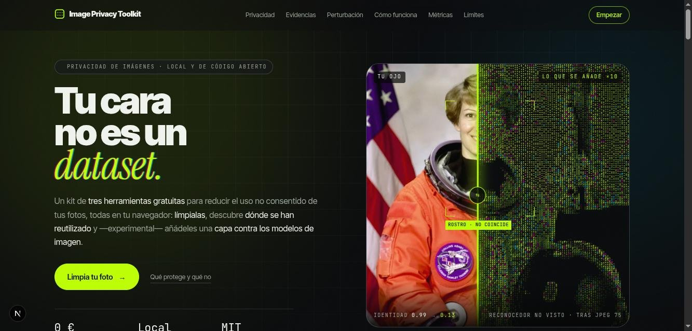
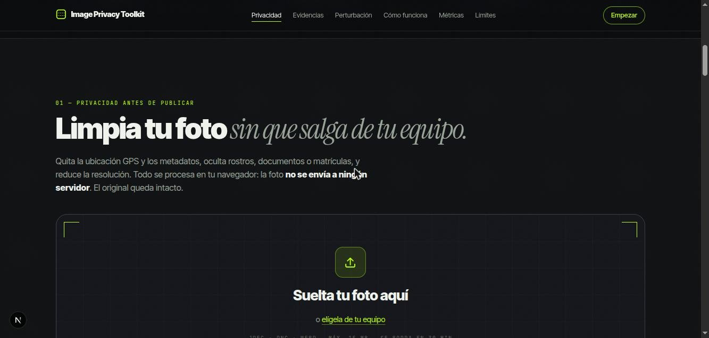
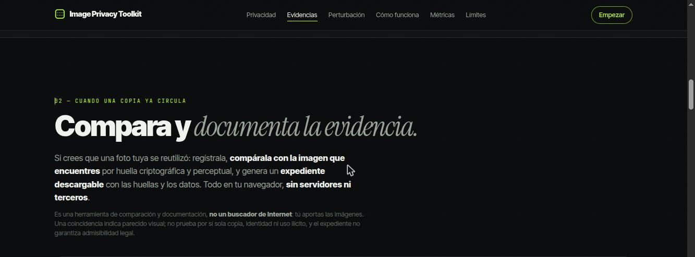
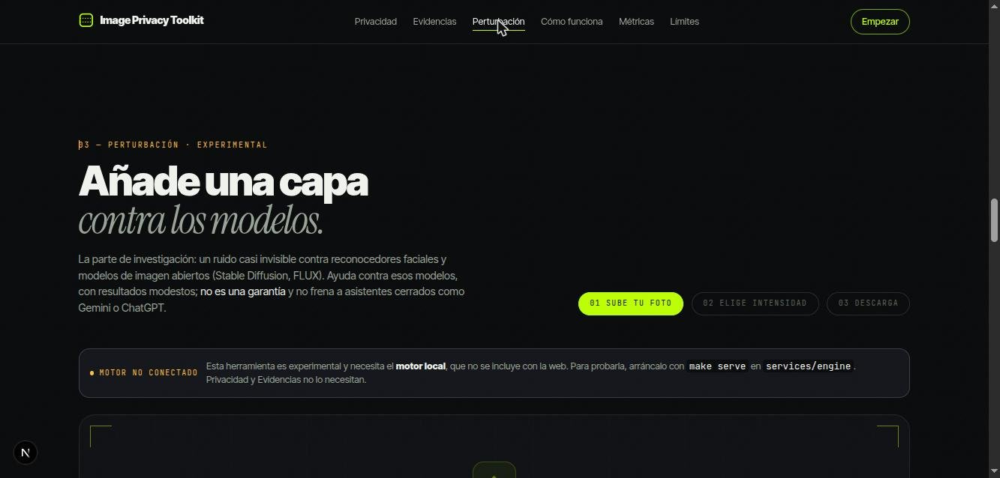
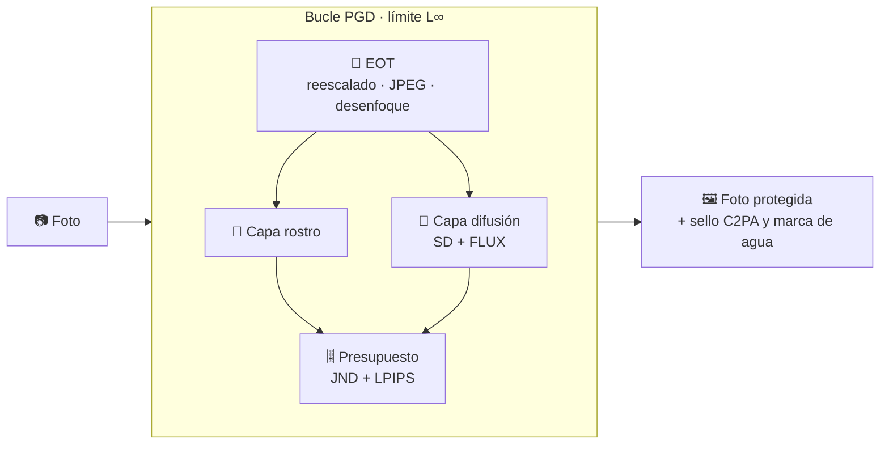
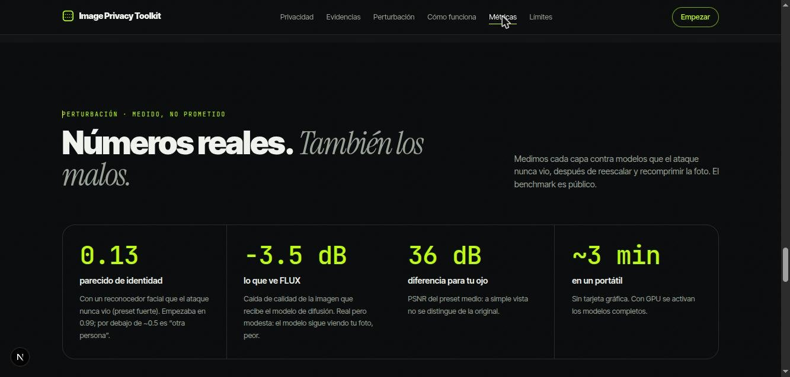

<div align="center">

# 🛡️ Image Privacy Toolkit

### Tu cara no es un dataset.

Kit de **tres herramientas gratuitas y de código abierto** para reducir el uso no consentido de tus fotos.
**Todo corre en tu navegador — tus imágenes no salen de tu equipo.**

<br/>


**[Privacidad](#-1--privacidad-local-recomendado) · [Evidencias](#-2--comparación-y-expediente-de-evidencias) · [Perturbación](#-3--perturbación-experimental) · [Métricas](#-métricas-medidas-no-prometidas) · [Investigación](#-estado-de-la-investigación) · [Contribuir](#-contribuciones)**

<br/>



</div>

<br/>

> [!IMPORTANT]
> **Honestidad por delante.** La limpieza de metadatos y la redacción local **sí funcionan** y son verificables (hay pruebas automatizadas). La perturbación es **investigación en curso**: ayuda contra los modelos que ataca, pero en una prueba real Gemini editó una foto protegida sin problema. Quitar metadatos **no anonimiza**: una cara, un documento o un lugar visibles pueden seguir identificándote. No prometemos inmunidad; medimos y publicamos todo, también lo que falla. Lee [docs/LIMITACIONES.md](docs/LIMITACIONES.md) antes de confiar en nada.

---

## 🧭 Qué es

Ayuda a **reducir** los riesgos de privacidad y el uso no consentido de tus fotografías: procesamiento **local**, eliminación de metadatos, ocultación de información identificativa e investigación reproducible sobre protección frente a ciertos usos de la IA.

No es una categoría nueva ni una solución a todo: ya existen editores que quitan metadatos, herramientas de difuminado y proyectos como Glaze, Fawkes, PhotoGuard o Nightshade. El valor está en **cómo integra las piezas**: limpieza y redacción 100% locales, una descripción honesta de lo que cada mecanismo logra y lo que no, y experimentos reproducibles cuyos resultados —incluidos los negativos— se publican.

| | Herramienta | Qué hace | Estado |
|:--:|---|---|:--:|
| 🧹 | **Privacidad local** | Quita EXIF/GPS, tapa caras y datos, recorta. La foto no sale del navegador. | ✅ Estable |
| 🔍 | **Comparación y evidencias** | Registra, compara por huella y genera un expediente descargable. Todo local. | ✅ Estable |
| ⚙️ | **Perturbación** | Ruido casi invisible contra reconocedores faciales y modelos de imagen abiertos. | 🧪 Experimental |

---

## 🧹 1 · Privacidad local (recomendado)



Arrastra una foto y:

- **Ves qué contiene el archivo**: si trae GPS, modelo de cámara, fecha… y se avisa de ello.
- **Tapas lo sensible**: difumina, pixela o cubre caras, matrículas o documentos. Hay un botón de detección de rostros (orientativo, revísalo a mano).
- **Recortas y bajas la resolución** si quieres compartir menos.
- **Descargas una copia limpia** y tu original queda intacto.

Todo ocurre en el navegador con `<canvas>`. Al redibujar y exportar, el archivo resultante contiene solo los píxeles: los metadatos del original no se copian. **No hay ninguna llamada de red en este flujo.**

<details>
<summary><b>Por qué puedes confiar en esto (pruebas)</b></summary>

```bash
cd apps/web
npm test                                   # detección de metadatos (Node)
# invariante de limpieza (necesita piexif/Pillow; el venv del motor los trae):
../../services/engine/.venv/bin/python tests/privacy_invariant.test.py
```

- `tests/readMetadata.test.mjs` verifica que se detecta el GPS/EXIF de un JPEG y que no se inventa en archivos sin metadatos.
- `tests/privacy_invariant.test.py` toma una imagen **con GPS** y comprueba que, tras la re-exportación del navegador, el resultado **no conserva GPS ni EXIF** y preserva la imagen.
- Al exportar, el código vuelve a leer el archivo generado y **se niega a descargarlo si aún tuviera EXIF**.

Verificación de punta a punta en un navegador real: [docs/DEMO_PRIVACIDAD.md](docs/DEMO_PRIVACIDAD.md).
</details>

---

## 🔍 2 · Comparación y expediente de evidencias



Cuando una copia ya circula, las protecciones preventivas no ayudan. Esta herramienta —**100% local, sin servidores ni terceros**— permite:

1. **Registrar** una foto: guarda su SHA-256, dos huellas perceptuales (pHash/dHash), fecha, notas y una miniatura — **nunca la foto completa** — en este navegador (IndexedDB).
2. **Comparar** una imagen que encuentres con tus registros: *archivo idéntico* (SHA-256), *similitud alta/posible* (hash perceptual) o *sin coincidencia*. Detecta bien **recompresión y reescalado** (distancia ≈ 0); **no** detecta recortes fuertes ni, de forma fiable, rotaciones ([docs/EVIDENCIAS.md](docs/EVIDENCIAS.md)).
3. **Documentar** la publicación (URL, plataforma, fecha, capturas — marcadas como *declaradas por ti*) y **generar** un expediente en **HTML imprimible** y **JSON**.

> **No es un buscador de Internet**: tú aportas las imágenes. Una coincidencia indica parecido visual; **no** prueba por sí sola copia, identidad ni uso ilícito, y el expediente **no** garantiza admisibilidad legal.

<details>
<summary><b>Pruebas</b></summary>

```bash
cd apps/web
npm test                                   # núcleo de comparación y expediente (Node)
# calibración del hash perceptual sobre transformaciones reales:
../../services/engine/.venv/bin/python tests/reuse_perceptual.test.py
```
</details>

---

## ⚙️ 3 · Perturbación (experimental)



Una sola optimización (PGD con límite L∞) combina tres capas:

| Capa | Contra qué | Cómo |
|---|---|---|
| **Rostro** | Face-swap, reconocimiento | Aleja la identidad que extrae un reconocedor facial (FaceNet/ArcFace), solo dentro de la cara |
| **Difusión** | img2img, inpainting, LoRA/DreamBooth | Arrastra el latente del VAE hacia una textura sin sentido (enfoque PhotoGuard/Mist), atacando a la vez la familia Stable Diffusion y la familia FLUX |
| **Legal** | Minería de datos | Escribe en los metadatos IPTC la reserva `DMI-PROHIBITED-AIMLTRAINING` |

Cada paso pasa la imagen por transformaciones aleatorias que imitan una subida a una red social (reescalado, JPEG diferenciable, desplazamiento de bloques, desenfoque), para que la protección sobreviva a la recompresión. Un presupuesto perceptual (máscara de textura + LPIPS) reparte el ruido donde el ojo no lo nota.



<details>
<summary><b>Presets y dónde corren</b></summary>

| Preset | Límite por píxel | Visibilidad | Dónde |
|---|---|---|---|
| Suave | ±4/255 | invisible | CPU |
| Media | ±8/255 | invisible | CPU |
| Fuerte | ±12/255 | textura fina visible al hacer zoom | CPU |
| Máxima | ±12/255, VAE completos | textura fina visible al hacer zoom | GPU |

En CPU, Suave/Media/Fuerte atacan sustitutos ligeros de los VAE (TAESD/TAEF1). Las métricas siempre se miden contra los VAE completos.
</details>

---

## 📊 Métricas (medidas, no prometidas)



Tras simular una subida a una red social (reescalado a 1080 px + JPEG 75), en un portátil Intel i7-8650U **sin GPU**:

| Preset | PSNR | LPIPS | Identidad (atacado) | Identidad (no visto) | VAE SD | VAE FLUX | VAE SDXL (no visto) | Tiempo |
|---|---|---|---|---|---|---|---|---|
| Media | 35.9 dB | 0.0015 | 1.00 → −0.15 | 0.99 → 0.48 | −0.6 dB | −1.6 dB | −0.6 dB | ~1 min |
| Fuerte | 31.3 dB | 0.0050 | 1.00 → −0.54 | 0.99 → 0.13 | −1.5 dB | −3.5 dB | −1.6 dB | ~1.2 min |

- **Identidad**: similitud coseno entre la cara original y la protegida. Por debajo de ~0.5 el reconocedor suele verla como otra persona. El *"modelo no visto"* es el dato más honesto.
- **Caída VAE**: cuánto empeora (dB) lo que el modelo de difusión "ve". SDXL nunca se ataca, así que mide transferencia.

> **Conclusión honesta.** La capa de rostro es sólida contra face-swap de código abierto (validado de punta a punta con un reconocedor no visto). La de difusión transfiere, pero su efecto es modesto con presets invisibles. **No transfiere a asistentes cerrados** (Gemini/ChatGPT). El muestreo es pequeño. Todo, incluidos los negativos, en [docs/MATRIZ_INVESTIGACION.md](docs/MATRIZ_INVESTIGACION.md).

```bash
cd services/engine
make bench
.venv/bin/python -m engine.eval.summary reports/*/report.json
```

---

## 🔒 Dónde se procesan tus datos

**Image Privacy Toolkit no envía tus fotos a terceros.** Privacidad y evidencias ocurren por completo en tu navegador. Solo la perturbación usa un motor que **tú** ejecutas.

```mermaid
flowchart TD
    A["📷 Tu foto"] --> N["🖥️ Tu navegador"]
    N --> P["🧹 Privacidad local<br/>quita EXIF/GPS · redacta · recorta"]
    N --> E["🔍 Evidencias<br/>huellas · comparación · expediente"]
    P --> O["⬇️ Copia limpia en tu equipo"]
    E --> O2["⬇️ Expediente HTML / JSON"]
    N -. "opcional" .-> M["⚙️ Motor de perturbación<br/>lo ejecutas tú, en tu máquina"]
    M -.-> O
    N -- "✗ nunca" --x T["☁️ Servidores de terceros"]
    style T fill:#2a0f0f,stroke:#ff5555,color:#ff9999
    style N fill:#1a1f0a,stroke:#d4ff3a
    style M fill:#141414,stroke:#888888
```



| Función | Dónde se procesa | ¿Sale del dispositivo? |
|---|---|---|
| Privacidad local | Tu navegador, con `<canvas>` | **No.** Ninguna llamada de red. |
| Comparación y evidencias | Tu navegador; registro en IndexedDB local | **No.** Ninguna llamada de red (solo una URL `blob:` en memoria). |
| Perturbación | El motor, que tú ejecutas | Viaja a **tu** motor por HTTP (localhost por defecto); no a terceros. No guarda nada: se borra a los 30 min. |

---

## 🔬 Estado de la investigación

Cada mecanismo está en un nivel distinto de madurez. La evidencia completa, con sus controles y limitaciones, está en [docs/MATRIZ_INVESTIGACION.md](docs/MATRIZ_INVESTIGACION.md).

| Mecanismo | Nivel | Qué muestra la evidencia |
|---|:--:|---|
| Privacidad local (metadatos, redacción, recorte) | ✅ **Verificado** | Eliminación de GPS/EXIF, tapado de una región y conservación del original, probados (navegador de escritorio, JPEG/PNG). No probado en todos los dispositivos/formatos. |
| Comparación + evidencias (SHA-256 + hash perceptual) | ✅ **Verificado** | Detecta copias idénticas, recomprimidas y reescaladas (distancia ≈ 0); no detecta recortes fuertes. Flujo completo verificado en navegador. |
| Protección frente al **entrenamiento** (unlearnable) | 🧪 **Experimental** | Resultados prometedores en condiciones controladas (CIFAR y Olivetti con *linear probe*), con un compromiso efecto/calidad. No demuestra que impida a Meta entrenar con tus fotos. |
| Protección frente a **face-swap** | 🧪 **Experimental** | Evaluación de extremo a extremo con `inswapper` y 8 pares de retratos, con un reconocedor no visto como juez. Evidencia de ese escenario, no garantía universal. |
| **Descripción/edición** por modelos comerciales (Gemini/ChatGPT) | ❌ **Negativo** | Los ensayos **no** mostraron transferencia suficiente. Se documenta como negativo; no se anuncia una protección que no se logra. |

Líneas, plan y cierres en [PLAN_TRABAJO](docs/PLAN_TRABAJO.md), [INVESTIGACION_TRANSFERENCIA](docs/INVESTIGACION_TRANSFERENCIA.md) y [HOJA_DE_RUTA](docs/HOJA_DE_RUTA.md). Visión de los módulos en [ARQUITECTURA](docs/ARQUITECTURA.md); registro de la investigación sobre asistentes cerrados y face-swap (con sus negativos) en [INVESTIGACION_ASISTENTES](docs/INVESTIGACION_ASISTENTES.md).

### 🤲 Investigación abierta: participa

La parte de perturbación es un **proyecto de investigación abierta**, y las preguntas difíciles siguen sin resolverse: que la protección transfiera a modelos cerrados, resistir el *adversarial training*, bajar el ruido visible manteniendo el efecto. Documentamos cada experimento con su control limpio, su control de ruido aleatorio y un juez no visto, y **publicamos también lo que falla**.

- 📌 **[docs/PREGUNTAS_ABIERTAS.md](docs/PREGUNTAS_ABIERTAS.md)** — las líneas sin resolver, cada una con lo que ya sabemos, lo que falta, el coste de cómputo y un criterio de éxito/fracaso fijado de antemano. **El mejor punto de entrada.**
- 📊 **[docs/MATRIZ_INVESTIGACION.md](docs/MATRIZ_INVESTIGACION.md)** — toda la evidencia medida, con controles y limitaciones.
- 🤝 **[CONTRIBUTING.md](CONTRIBUTING.md)** — cómo proponer y correr un experimento que cuente como evidencia.

> Si **refutas** uno de nuestros resultados con un experimento mejor controlado, eso también es una contribución valiosa.

---

## 🚀 Ejecutar en tu equipo

Requisitos: **Node 22** (para la web) y, si quieres la perturbación, **Python 3.12**.

```bash
# Web (incluye el estudio de privacidad local; no necesita el motor)
cd apps/web
npm install
npm run dev           # http://localhost:3000

# Motor de perturbación, opcional (la primera vez descarga ~1 GB de modelos)
cd services/engine
make dev
make serve            # http://localhost:8000
```

La web lee la dirección del motor de `.env.local` (`cp .env.example .env.local`). El estudio de privacidad funciona aunque el motor esté apagado. Con Docker: `docker compose up --build`.

Perturbación desde la terminal, sin interfaz:

```bash
cd services/engine
.venv/bin/python -m engine.protect foto.jpg --preset media --owner "Tu nombre"
```

---

<details>
<summary><h3>🧱 Arquitectura y referencia (estructura, API, variables, modelos)</h3></summary>

### Estructura

```
apps/web/          Next.js 15 · interfaz web
  src/components/PrivacyStudio.tsx   estudio de privacidad local (navegador)
  src/components/EvidenceStudio.tsx  registro + comparación local + expediente
  src/lib/privacy.ts                 limpieza de metadatos, redacción, recorte
  src/lib/reuse.ts                   SHA-256, hash perceptual, comparación, expediente
  src/lib/reuseImage.ts              huellas desde <canvas>; reuseStore.ts: registro (IndexedDB)
  tests/                             pruebas de privacidad y de comparación (Node + Python)
services/engine/   FastAPI + PyTorch · motor de perturbación (experimental)
  engine/protect/  capas (face, vae), transformaciones (eot), presupuesto, pipeline
  engine/eval/     benchmark de eficacia y visibilidad
  engine/research/ experimentos (incluye resultados negativos)
docs/              limitaciones, matriz de investigación y hoja de ruta
```

### API del motor

| Método | Ruta | |
|---|---|---|
| `POST` | `/jobs` | `file` + `preset` → `{id}` |
| `GET` | `/jobs/{id}` | estado y progreso |
| `GET` | `/jobs/{id}/events` | progreso en vivo (SSE) |
| `GET` | `/jobs/{id}/result?format=png\|jpeg` | imagen protegida |
| `GET` | `/jobs/{id}/record` | certificado de derechos firmado (JSON) |
| `DELETE` | `/jobs/{id}` | cancelar |
| `POST` | `/verify` | lee el sello de una imagen (marca de agua + C2PA): «¿esta imagen es mía?» |
| `GET` | `/presets` | presets disponibles |
| `GET` | `/health` | estado del motor y dispositivo |

### Variables del motor

| Variable | Por defecto | Para qué |
|---|---|---|
| `ENGINE_PRESETS` | `suave,media,fuerte` | Presets disponibles; añade `maxima` si hay GPU |
| `ENGINE_DEVICE` | automático | `cuda`, `mps` o `cpu` |
| `ENGINE_THREADS` | núcleos físicos | Hilos de PyTorch en CPU |
| `ENGINE_WORKERS` | `1` | Trabajos simultáneos |
| `ENGINE_CORS` | `http://localhost:3000` | Orígenes permitidos |
| `ENGINE_MAX_UPLOAD_MB` | `15` | Tamaño máximo de subida |
| `ENGINE_JOB_TTL` | `1800` | Segundos que se conserva un resultado |

### Modelos y licencias

Los modelos los descarga cada usuario; **no se distribuyen en este repositorio**. La mayoría son de licencia permisiva, pero **dos no lo son** y están marcados. La licencia MIT cubre el **código**, no los modelos.

| Modelo | Uso | Licencia |
|---|---|---|
| FaceNet InceptionResnetV1 (VGGFace2) + MTCNN — `facenet-pytorch` | capa de rostro | MIT |
| `stabilityai/sd-vae-ft-mse` | difusión SD (preset máxima) y evaluación | MIT |
| VAE de `ostris/Flex.1-alpha` (derivado de FLUX.1-schnell) | difusión FLUX (preset máxima) y evaluación | Apache-2.0 |
| `madebyollin/taesd`, `madebyollin/taef1` | sustitutos ligeros en CPU | MIT |
| `madebyollin/sdxl-vae-fp16-fix` | solo evaluación (modelo no atacado) | MIT |
| FaceNet (CASIA-WebFace) | solo evaluación (modelo no atacado) | MIT |
| LPIPS (AlexNet) | presupuesto perceptual | BSD-2 |
| **InsightFace ArcFace** (`buffalo_l`, `antelopev2`) | capa de rostro (ArcFace) | **solo investigación no comercial** |
| **inswapper_128** (InsightFace) | evaluación de face-swap | **solo investigación no comercial** |

Las funciones que dependen de InsightFace ArcFace heredan su restricción **no comercial**, independientemente de la licencia MIT del código. Detalles y avisos de terceros en [LICENSING.md](LICENSING.md).

</details>

---

## 🤝 Contribuciones

Las aportaciones son bienvenidas de tres formas, y las tres valen: **código** (errores, interfaz, accesibilidad, motor), **investigación** (diseñar y correr experimentos, incluidos los que fallan) y **documentación/pruebas**. Guía completa en **[CONTRIBUTING.md](CONTRIBUTING.md)**.

- **Informar de un error:** abre una *issue* con qué esperabas, qué ocurrió y pasos para reproducirlo.
- **Investigar:** parte de las [preguntas abiertas](docs/PREGUNTAS_ABIERTAS.md). Un experimento solo cuenta como evidencia si trae control limpio, control de ruido aleatorio, un **modelo no visto** como juez, una transformación realista (reescalado + JPEG) y un criterio de éxito escrito **antes** de ver los resultados.
- **Contribuir código:** abre un *pull request*; antes de enviarlo deben pasar:

```bash
cd apps/web && npm run lint && npx tsc --noEmit && npm test
```

Mantén el estilo del código y la honestidad de la documentación: nada de afirmaciones de eficacia sin una medición que las respalde, ni promesas de protección "garantizada". No introduzcas llamadas de red en los flujos locales, ni incluyas fotografías privadas, claves o modelos de gran tamaño.

---

## 📄 Autoría y licencia

Creado y mantenido por **Yuthramys Ibarra** · Copyright © 2026 Yuthramys Ibarra.

Bajo la **[Licencia MIT](LICENSE)**: puedes usar, modificar, distribuir y también **vender** el código, incluso en productos cerrados, conservando el aviso de copyright y licencia. No hay tarifas ni suscripción. El código original es de la autora; los modelos preentrenados y las imágenes de muestra pertenecen a sus autores y conservan su licencia (ver [LICENSING.md](LICENSING.md)).

La gratuidad del **código** no es lo mismo que el coste de un **alojamiento web**: una demo pública tendría un coste de operación que no cambia la licencia. Algunas funciones dependen de modelos con licencia no comercial (ver arriba).

Si el proyecto te sirve, puedes apoyarlo con una donación voluntaria (ver [`.github/FUNDING.yml`](.github/FUNDING.yml)); no hace falta para usarlo.

<div align="center">
<br/>

**[⬆ Volver arriba](#-image-privacy-toolkit)**

</div>
